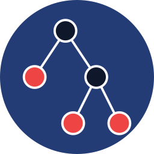

# rowan

> [!WARNING]
> **rowan is experimental.** It is extensively tested (about 1,500 example programs, checked
> against real Python, pandas, pydantic, FastAPI and PyTorch runs), but it has not been used in
> practice on real code bases. On large programs (thousands of lines and up) it may be slow or
> crash.



**rowan shows you what your Python program does without running it.** Install
[rowan from the Visual Studio Marketplace](https://marketplace.visualstudio.com/items?itemName=Rowan.rowan)
and hover over any name in a Python file:

* **what it holds**, written as Python: literals, dicts with their keys, lists, instances,
  DataFrames with their columns, tensors with their shapes, or `?` for what rowan cannot know;
* **what the code needs of it**: the keys, columns and attributes a function reads of its
  parameters and of its inputs (JSON, CSV, environment variables, requests), i.e. the schema
  the code assumes;
* **what each of your calls gives it**, and which call breaks a function;
* for PyTorch and numpy: **the shape of every tensor**, in the function's own terms.

Accesses that may fail (a key set on some paths only, a typo, a column a merge renamed, a tensor
of the wrong shape) are underlined as problems.

rowan follows every branch and every call of your program, and also analyses each function for
any call of it. It knows the standard library, pandas, pydantic, FastAPI, PyTorch and numpy well
enough to compute exact results on known data, and stays honest where it can't: an unknown value
is `?`, never a guess.

## Examples

Each example is a complete file; the hovers and problems below are what rowan shows for it.

### Dicts: what a function needs, and which call breaks it

```python
def make_user(row, admin=False):
    user = {"id": row["id"], "name": row["name"].strip().title()}
    if admin:
        user["role"] = "admin"
        user["since"] = row["since"]
    return user


ada = make_user({"id": 1, "name": "  ada lovelace ", "since": 1843}, admin=True)
bob = make_user({"id": 2, "name": "bob"}, admin=True)
eve = make_user({"id": 3, "name": "eve"})
```

Hovering `row`:

> ```python
> row = (parameter)
> ```
>
> **Requirements**
> - `row["id"]`
> - `row["name"]`
> - `row["since"]` (only if `admin`)
>
> **In Calls**
> - `{"id": 1, "name": "  ada lovelace ", "since": 1843}` on line 9.
> - `{"id": 2, "name": "bob"}` on line 10: ✗ `row["since"]`
> - `{"id": 3, "name": "eve"}` on line 11.
>
> **Notes**
> - `(only if x)` needed only on calls where `x` holds of the arguments as passed · ✗ fails on every path

`row["since"]` on line 5 is underlined: *key "since" is never set (via L10)*. Hovering `ada`
shows the value computed exactly, string methods included:

> ```python
> ada = {
>   "id": 1,
>   "name": "Ada Lovelace",
>   "role": "admin",
>   "since": 1843
> }
> ```
>
> **Allocation Sites**
> - created on line 2

### The schema your code assumes

```python
import json
import os


def load_config():
    cfg = json.loads(os.environ["APP_CONFIG"])
    db = cfg["database"]
    url = f"postgres://{db['user']}@{db['host']}:{db.get('port', 5432)}/{db['name']}"
    if cfg.get("debug"):
        print("tracing", cfg["trace_level"])
    return url
```

Hovering `cfg` on line 6:

> ```python
> cfg = json.loads(os.environ["APP_CONFIG"])
> ```
>
> **Requirements**
> - `cfg["database"]["host"]`
> - `cfg["database"]["name"]`
> - `cfg["database"]["user"]`
> - on some paths: `cfg["trace_level"]`

Nested reads are traced back to where the data came from; `.get` reads require nothing, and a
read behind a condition is needed on some paths only.

### pandas: columns through merges and groupbys

```python
import pandas as pd

orders = pd.DataFrame([
    {"order_id": 1, "customer": "ann", "amount": 12.5, "region": "north"},
    {"order_id": 2, "customer": "bo", "amount": 7.0, "region": "south"},
    {"order_id": 3, "customer": "ann", "amount": 20.0, "region": "north"},
])
customers = pd.DataFrame({"customer": ["ann", "bo"], "region": ["north", "south"], "tier": ["gold", "basic"]})

joined = orders.merge(customers, on="customer")
by_region = joined.groupby("region_x", as_index=False)["amount"].sum()
oops = joined["region"]


def monthly(path):
    df = pd.read_csv(path, parse_dates=["ts"])
    df["month"] = df["ts"].dt.month
    return df.groupby(["month", "category"])["price"].mean().reset_index()
```

Hovering `joined`:

> ```python
> joined = DataFrame[
>   "amount",
>   "customer",
>   "order_id",
>   "region_x",
>   "region_y",
>   "tier"
> ]
> ```
>
> **Allocation Sites**
> - never has key "region" here

so `joined["region"]` is underlined: *column "region" was removed or renamed on every path to
here*. Hovering `by_region` shows `by_region = DataFrame["amount", "region_x"]`. `monthly` is
never called, yet hovering
its `df` on line 16 gives the columns the CSV file must have:

> ```python
> df = DataFrame[**?]
> ```
>
> **Requirements**
> - `df["category"]`
> - `df["price"]`
> - `df["ts"]`
>
> **Notes**
> - `**?` other keys may exist

### PyTorch: shapes in the function's own terms

```python
import torch
import torch.nn as nn
import torch.nn.functional as F


class Attention(nn.Module):
    def __init__(self, n_embd, n_head):
        super().__init__()
        self.n_head = n_head
        self.qkv = nn.Linear(n_embd, 3 * n_embd)
        self.proj = nn.Linear(n_embd, n_embd)

    def forward(self, x):
        B, T, C = x.shape
        q, k, v = self.qkv(x).split(C, dim=2)
        q = q.view(B, T, self.n_head, C // self.n_head).transpose(1, 2)
        k = k.view(B, T, self.n_head, C // self.n_head).transpose(1, 2)
        v = v.view(B, T, self.n_head, C // self.n_head).transpose(1, 2)
        att = F.softmax(q @ k.transpose(-2, -1), dim=-1)
        y = (att @ v).transpose(1, 2).reshape(B, T, C)
        return self.proj(y)


attn = Attention(64, 4)
out = attn(torch.randn(2, 10, 64))
bad = attn(torch.randn(2, 10, 32))
```

Hovering `att`:

> ```python
> att = Tensor[B, self.n_head, T, T]
> ```
>
> **In Calls**
> - `Tensor[2, 4, 10, 10]` on line 25.
>
> **Notes**
> - `B`: `x.shape[0]`
> - `T`: `x.shape[1]`

Hovering `x`:

> ```python
> x = (parameter)
> ```
>
> **Requirements**
> - `x.dim() == 3`
> - `x.shape[2] == n_embd`
>
> **In Calls**
> - `Tensor[2, 10, 64]` on line 25.
> - `Tensor[2, 10, 32]` on line 26: ✗ (Linear(64 -> 192) given last dim 32)
>
> **Notes**
> - ✗ fails on every path

Line 15 is underlined: *shape mismatch: Linear(64 -> 192) given last dim 32 (via L26)*.

### FastAPI and pydantic, through the test client

```python
from typing import Literal

from fastapi import FastAPI, HTTPException
from fastapi.testclient import TestClient
from pydantic import BaseModel, Field

app = FastAPI()
ORDERS = {}


class OrderIn(BaseModel):
    item: str
    qty: int = Field(gt=0)
    size: Literal["S", "M", "L"] = "M"


@app.post("/orders/{oid}")
def create(oid: int, order: OrderIn):
    if oid in ORDERS:
        raise HTTPException(status_code=409, detail="exists")
    ORDERS[oid] = order
    return {"id": oid, "item": order.item, "total": order.qty * 2.5}


client = TestClient(app)
ok = client.post("/orders/1", json={"item": "tea", "qty": "4"})
dup = client.post("/orders/1", json={"item": "tea", "qty": 1})
bad = client.post("/orders/2", json={"item": "tea", "qty": 0, "size": "XL"})
ok_body, ok_code = ok.json(), ok.status_code
dup_code, bad_code = dup.status_code, bad.status_code
```

Hovering the names on the last two lines:

```python
ok_body = {"id": 1, "item": "tea", "total": 10.0}
ok_code = 200
dup_code = 409
bad_code = 422
```

Requests go through routing, parameter conversion, pydantic validation (`"4"` becomes `4`,
`qty=0` breaks `gt=0`, `"XL"` is not one of the `Literal`'s values) and the handler.

### Exact values from the standard library

```python
import datetime
import json
import re
import sqlite3

LOG = """2024-03-01T10:00 INFO user=ann amount=12.5
2024-03-01T11:30 WARN user=bo amount=7
2024-03-02T09:15 INFO user=ann amount=20"""

PAT = re.compile(r"(\S+) (\w+) user=(\w+) amount=([\d.]+)")
rows = [PAT.match(line).groups() for line in LOG.splitlines()]

db = sqlite3.connect(":memory:")
db.execute("CREATE TABLE ev (ts TEXT, user TEXT, amount REAL)")
db.executemany("INSERT INTO ev VALUES (?, ?, ?)", [(ts, user, float(amt)) for ts, _, user, amt in rows])
per_user = dict(db.execute("SELECT user, SUM(amount) FROM ev GROUP BY user ORDER BY user").fetchall())

first = datetime.datetime.fromisoformat(rows[0][0])
label = first.strftime("%A %d %B, %H:%M")
summary = json.dumps({"users": per_user, "since": label}, sort_keys=True)
```

Hovering `per_user`, `first` and `label`:

```python
per_user = {"ann": 32.5, "bo": 7.0}
first = datetime.datetime(2024, 3, 1, 10, 0)
label = "Friday 01 March, 10:00"
```

The regular expressions, the SQL, `datetime` and `json` compute what CPython would. With a log
read from a file instead, the same names show `?`: rowan never guesses a value it can't compute.

## Reading a hover

A hover starts with `name = value`, written as Python (a parameter: `name = (parameter)`, with its
type or default when known), followed by up to four sections:

* **Requirements**: what the code reads of a parameter for any call of its function
  (`row["id"]`, `row["since"]` *(only if `admin`)*, `x.dim() == 3`), or of an input read on that
  line (`cfg = json.loads(…)`); those behind a condition together, *on some paths: …*;
* **In Calls**: what each of your program's own calls gives (or passes, for a parameter), with
  the reads that fail for it (`✗ row["since"]`); the values one line gives, together (`10 | 14`);
* **Allocation Sites**: where its objects were made, and keys they never have there;
* **Notes**: where the unknowns come from and what the names the value mentions are; when the
  analysis was cut short; last, one line saying what each mark and rowan's own notation used
  above mean (the tables below; typing's `list[X]` or `int | None` are not explained).

| in values | means |
| --- | --- |
| `?` | a value rowan cannot know (it depends on input, or on code rowan cannot see) |
| `int(?)` | an int whose value is not known |
| `a \| b` | one of these, depending on the path or the call (`None` last: `int(?) \| None`) |
| `"k"?: v` | a key present on some paths only |
| `"k"~: v` | present unless code rowan cannot see removed it |
| `**?` | other keys or attributes may exist |
| `list[X]` | a list of any length whose elements are like `X` (typing notation: `set[X]`, `tuple[X, ...]`, `dict[K, V]` too) |
| `DataFrame["a", "b"]` | a DataFrame's columns |
| `Tensor[B, T, 4*C]` | a tensor's shape (named dims are explained in the Notes) |
| `…` | not shown |

| marks | means |
| --- | --- |
| `✗` | fails on every path that reaches it |
| `⚠` | fails on some paths |

rowan does not warn about a key computed from data, nor about one only code it cannot see could
have set (a decorator of a library, say): it can't tell, and such warnings were mostly wrong.

Files are analysed when opened or saved, or with **Rowan: Analyse current file**. When a whole
file takes longer than a second, rowan answers each function when you first hover in it, alone
and for any call of it (usually well under a second), and says so in the status bar.

## Installing

* **VS Code:** install [rowan from the Marketplace](https://marketplace.visualstudio.com/items?itemName=Rowan.rowan).
  It bundles the engine for macOS (Apple silicon and Intel), Linux (x64 and arm64) and Windows
  (x64); nothing else is needed. The `.vsix` package of each version and platform is also
  attached to the [GitHub releases](https://github.com/kaidaniel/rowan/releases)
  (**Extensions: Install from VSIX…**). Its settings are in the
  [extension's README](vscode-rowan/README.md).
* **Command line:** build the engine with Rust (`cd rowan && cargo build --release`), then
  `rowan/target/release/rowan your_file.py` prints what rowan found: the accesses that may fail,
  the values of the module's names, and what the code reads from its inputs.

## What rowan knows

* **Python and its standard library**, exact on known values: builtins; str / bytes / dict /
  list / set methods and formatting; `collections`, `itertools`, `functools`, `operator`,
  `heapq`, `bisect`; dataclasses, enum, NamedTuple, TypedDict; `re`, `string.Template`,
  `textwrap`, `shlex`, `html`, `base64`, `urllib.parse`; `json`, `csv`, `configparser`,
  `sqlite3` (in-memory SQL); `math`, `statistics`, `decimal`, `fractions`, `datetime`;
  `os.environ`, `os.path`, `pathlib`, `argparse`, `contextlib`, `threading` /
  `concurrent.futures`, `copy`, `logging`.
* **pandas:** a DataFrame's columns through construction, selection, stores, drops and renames,
  `merge` / `join`, `concat`, `groupby` aggregates, pivots and reshapes; for a frame built from
  literal data, its values too (`list(df["sku"])`, `df.loc[0, "sku"]`, each row of a loop over
  `iterrows()`). Files read with `read_csv` and friends have whatever columns the code reads.
* **pydantic** (v2 and v1 spellings): fields and aliases, validation, nested models,
  validators, dumps and their options, `ValidationError.errors()`, `BaseSettings`.
* **FastAPI:** routes, parameters converted by annotation, dependencies, middlewares,
  exception handlers, `response_model`, and what `TestClient` reads back.
* **PyTorch and numpy:** symbolic shapes through creation, broadcasting, `matmul` / `einsum`,
  shape operations, reductions, indexing and `nn` layers. dtype and device are not tracked.

Your own modules are followed through their imports, and so are the installed packages your
code imports (the extension's `rowan.followPackages`, on by default): rowan reads them from the
site-packages of the Python interpreter you selected and runs them like your own code, within
a budget of work. A call it does not follow, or one past that budget, is code rowan cannot see:
it is taken to be able to do anything to what it is given.

## What you can rely on

What a hover or problem states holds for every run of your program: a value shown, a key shown
as always there, a read marked `✗` or `⚠`. This assumes rowan's knowledge of the libraries
above is right, and that annotations are true (a function analysed for any call takes
`x: Foo` to be a `Foo`). `exec` / `eval` of code built at run time, `setattr` / `getattr` with
names not known, metaclasses and monkey-patching are not followed. Readings marked `~` assume
that code rowan cannot see removed nothing, and say so. An analysis cut short is still right,
only less precise.

## What rowan does not do

* It does not run your program, and it does not guess: what it cannot work out is `?`.
* It is not a type checker or a linter. It does not check that annotations agree with each
  other, or style; it shows values, keys, columns and shapes, and the accesses that may fail.
* It does not track a tensor's dtype or device.
* On large programs it may give up on a whole-file analysis after 10 seconds; hovers then
  analyse one function at a time, which says less about what the rest of the program passes.

## More

Working on rowan itself: [`AGENTS.md`](AGENTS.md) and [`rowan/README.md`](rowan/README.md).
